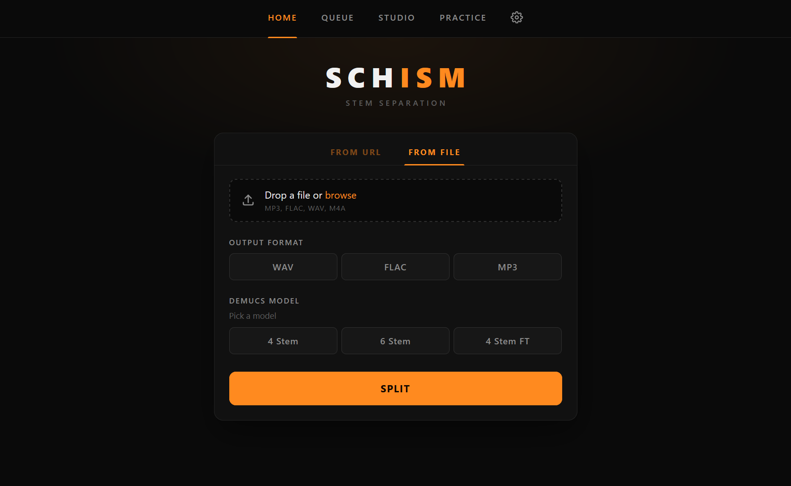
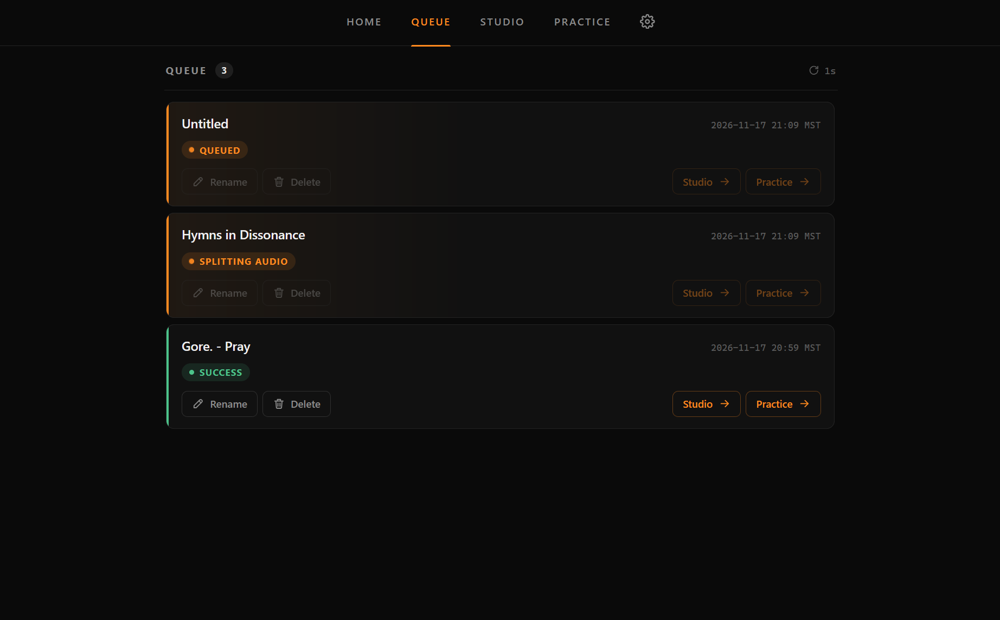
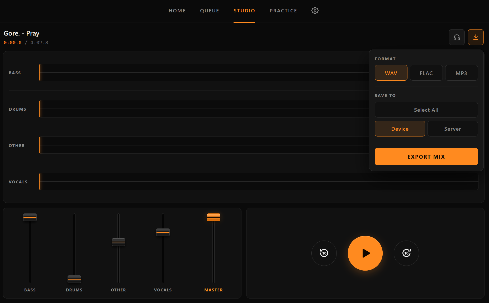
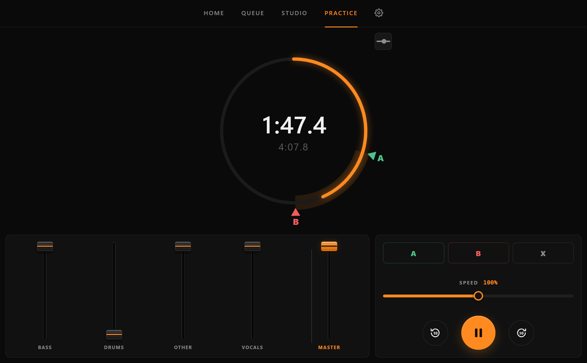

# Schism

Self-hosted stem separation. Paste a link or drop in an audio file, and Schism splits it into vocals, drums, bass and more with [Demucs](https://github.com/adefossez/demucs). Then mix the stems or practice along with them, right in your browser.

## How it works

1. **Add a job.** Paste a URL or drop in a file on the home page, then pick an output format and a model.

   

2. **It waits in the Queue.** Jobs run one at a time. URL jobs download the audio first with yt-dlp, then Demucs splits it into stems.

   

3. **Open it.** When a job finishes, open it in Studio or Practice. The browser downloads every stem and decodes it all up front, so the stems stay perfectly in sync and seeking is instant. This can take a little while for long songs or on slower devices.

4. **Use it.** Mix and export in Studio, or play along in Practice.

   

   

## Features

- **Split from a URL or a file.** URLs are downloaded with [yt-dlp](https://github.com/yt-dlp/yt-dlp) (YouTube and [many other sites](https://github.com/yt-dlp/yt-dlp/blob/master/supportedsites.md)). Files can be MP3, FLAC, WAV or M4A.
- **Three models.**
  - **`htdemucs`:** 4 stems: vocals, drums, bass, other.
  - **`htdemucs_6s`:** 6 stems. Adds guitar and piano.
  - **`htdemucs_ft`:** fine-tuned 4 stems. Cleaner, but about 4x slower.
- **Studio.** Mix the audio with a fader for each stem, then export the mix to your device or save it on the server (or both).
- **Practice.** Mute or turn down any stem, control the audio speed without changing its pitch, and loop a section. Requires HTTPS (see [HTTPS for Practice](#https-for-practice)).
- **Queue.** Jobs run one at a time. Rename, retry or delete them.
- **Works on your phone.** Over HTTPS, it can also be installed to your home screen as a PWA (Progressive Web App), built with [vite-plugin-pwa](https://vite-pwa-org.netlify.app).

## Install

Schism runs in Docker. Use either Docker Compose (recommended) or `docker run`.

### Docker Compose

1. Create a directory for Schism and add a `docker-compose.yml`:

   ```yaml
   services:
     app:
       container_name: schism
       image: ghcr.io/navarroerk/schism:latest
       ports:
         - "8212:8212"
       volumes:
         - ./data/jobs:/app/jobs
         - ./data/logs:/app/logs
         - ./data/models:/app/models
       environment:
         - TZ=UTC
         - PUID=1000
         - PGID=1000
         - YTDLP_AUTO_UPDATE=true
       restart: unless-stopped
   ```

2. Start it:

   ```bash
   docker compose up -d
   ```

3. Open `http://<your-server-ip>:8212`.

To update:

```bash
docker compose pull
docker compose up -d
```

Your data in `data/` is kept.

### Docker Run

From the directory where you want Schism's data:

```bash
docker run -d --name schism -p 8212:8212 \
  -v "$(pwd)/data/jobs:/app/jobs" \
  -v "$(pwd)/data/logs:/app/logs" \
  -v "$(pwd)/data/models:/app/models" \
  -e TZ=UTC -e PUID=1000 -e PGID=1000 -e YTDLP_AUTO_UPDATE=true \
  --restart unless-stopped \
  ghcr.io/navarroerk/schism:latest
```

To update, pull the new image, remove the container and run the same command again:

```bash
docker pull ghcr.io/navarroerk/schism:latest
docker rm -f schism
```

Your data in `data/` is kept.

## Settings

| Variable            | Default | What it does                                                                                                                      |
| ------------------- | ------- | --------------------------------------------------------------------------------------------------------------------------------- |
| `TZ`                | `UTC`   | Timezone for job dates, e.g. `America/Denver`. [List of timezones](https://en.wikipedia.org/wiki/List_of_tz_database_time_zones)  |
| `PUID` / `PGID`     | `1000`  | The user and group that own the files Schism creates. Run `id` on your server to find yours.                                      |
| `YTDLP_AUTO_UPDATE` | `true`  | Updates yt-dlp each time the container starts, so URL downloads keep working. Set to `false` to stay on the version in the image. |

## Folders

| Folder        | What's in it                                                                     |
| ------------- | -------------------------------------------------------------------------------- |
| `data/jobs`   | Every job: the original audio, the stems, and any mixes saved to the server.     |
| `data/models` | Demucs models, downloaded the first time each model is used (80 to 320 MB each). |
| `data/logs`   | Server logs.                                                                     |

Jobs stay until you delete them in the Queue, so `data/jobs` grows over time. A job takes roughly 50 to 800 MB depending on the audio length, number of stems, and output format.

To store jobs somewhere with more space, like a NAS or a second drive, change the left side of the jobs volume to that path, e.g. `/path/to/storage:/app/jobs`. The folder must be writable by your `PUID` user.

## Hardware

Schism runs on the CPU. No GPU is needed.

- **RAM:** at least 3 GB free for splitting, 4 GB recommended for longer audios (8+ minutes).
- **Speed:** Dependent on the CPU. On a typical modern CPU, a 4 minute song takes roughly 1 to 4 minutes with the 4 or 6 stem model. The fine-tuned model takes roughly 4 times as long.

## Tags

| Tag      | What it is                               |
| -------- | ---------------------------------------- |
| `latest` | The newest release.                      |
| `1.2.3`  | One exact release. Never changes.        |
| `1.2`    | The newest `1.2.x` release (fixes only). |
| `dev`    | Latest development build. May be broken. |

## Security

Schism has no login. Anyone who can reach it can add, play and delete jobs, and make your server download from any valid URL. Don't expose it to the internet as is.

Ways to run it safely, and get HTTPS (needed for Practice and installing the PWA):

- **Home network only:** works as is over HTTP, except Practice and the PWA.
- **[Tailscale](https://tailscale.com):** private access from anywhere through a VPN. Its `tailscale serve` command also gives you HTTPS.
- **Reverse proxy:** [Caddy](https://github.com/caddyserver/caddy), [Nginx Proxy Manager](https://nginxproxymanager.com) or [Traefik](https://github.com/traefik/traefik) give you HTTPS. If it's reachable from the internet, add a login in front, like [Authelia](https://www.authelia.com) or [Authentik](https://github.com/goauthentik/authentik).
- **[Cloudflare Tunnel](https://developers.cloudflare.com/tunnel/) with Cloudflare Access:** HTTPS and a login without opening any ports.

## Notes from the Developer

### File Handling

Manage your jobs (rename, delete) from the web app, not by editing the files directly.

- **Copy stems, don't move them.** To use stems in a DAW, copy them out of the jobs folder. If a job's stems go missing, Studio and Practice can't load it.
- **Don't edit or delete `jobs.json`.** It's how Schism keeps track of your jobs. A bad edit can make jobs disappear from the Queue, even though their files are still there.

### Jobs can't be stopped

Once a job is added, it can't be cancelled or removed from the queue while it's waiting or running. Wait for it to finish (or fail), then delete it.

**Coming soon:**

- Cancelling jobs that are waiting in the queue
- Stopping a job while the stems are being split

### Compressed playback

By default, Studio and Practice play smaller MP3 copies of WAV and FLAC stems so they load faster (MP3 jobs are already small and play as they are). The copies are made the first time you open a job and kept in the job's `preview` folder. Exports always use the original stems, so this never affects export quality. Turn it off in Settings to play the originals.

### Stem quality

Stems are made by [Demucs](https://github.com/adefossez/demucs), an AI model that estimates each instrument from the mixed song. Results depend on the audio: expect some minor bleed between stems. Instruments the model doesn't have a stem for end up in "other".

### HTTPS for Practice

Practice only works over HTTPS, or on `localhost` if you run Schism on the same computer you're using. Practice uses [SoundTouchJS](https://www.npmjs.com/package/@soundtouchjs/audio-worklet) to change the speed without changing the pitch, and browsers only allow it to run on secure (HTTPS) pages. Over plain `http://<server-ip>:8212`, Practice shows a "requires HTTPS" message.
Studio, Queue and everything else work fine over HTTP.
**Fix:** serve Schism over HTTPS. See [Security](#security) for options.

### Time to Split Stems

Split time depends on:

- **Song length:** longer audio takes proportionally longer.
- **Model:** `htdemucs_ft` takes roughly four times as long as `htdemucs`.
- **CPU:** performance varies significantly between processors.
- **Output format:** MP3 requires additional encoding time, making WAV the fastest format to split. MP3 output, however, produces significantly smaller files, reducing disk usage and load times in Studio and Practice.
- **First use of a model:** the model is downloaded before the first split.

### Disclaimer

Only download and split audio you have the right to use. You're responsible for what you do with Schism.

## License

[MIT](LICENSE)
